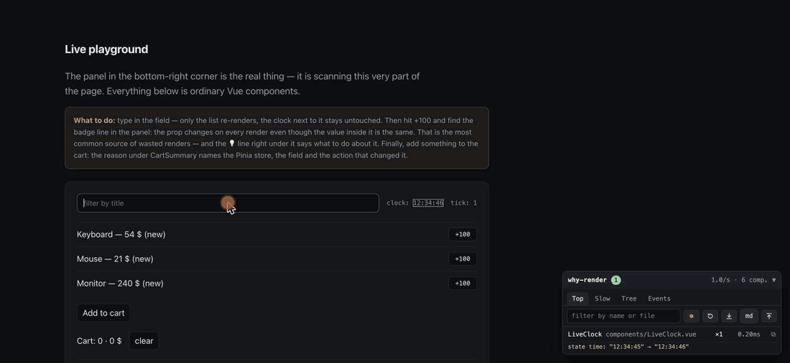

# vue-why-render

See which Vue components re-render — and **why exactly**.

[](https://www.npmjs.com/package/vue-why-render)
[](https://npmtrends.com/vue-why-render)
[](https://github.com/dadashi44/vue-why-render/blob/main/LICENSE)

**[Live demo →](https://vue-why-render.js.org/)** · [Русский](https://github.com/dadashi44/vue-why-render/blob/main/docs/README.ru.md) · [中文](https://github.com/dadashi44/vue-why-render/blob/main/docs/README.zh-CN.md)



Other tools flash a border around a component that just updated. That is enough to
notice a problem, but not to fix it — you are still left asking *what actually changed?*
`vue-why-render` answers that: it names the exact reactive dependency that triggered
the render.

```
ProductCard ×7 · 2.4ms · badge
└─ prop badge: { text } → { text } — new reference, same value
```

In React you have to guess this by diffing props. Vue hands you the reason itself,
through the `renderTriggered` hook — this package is built around it.

## Install

```sh
npm install -D vue-why-render
pnpm add -D vue-why-render
yarn add -D vue-why-render
bun add -d vue-why-render
```

Requires Vue 3.3+. The package has no runtime dependencies.

## Usage

```ts
// Vue: main.ts
import { createApp } from 'vue'
import VueWhyRender from 'vue-why-render'
import App from './App.vue'

createApp(App).use(VueWhyRender).mount('#app')
```

```ts
// Nuxt: nuxt.config.ts
export default defineNuxtConfig({
    modules: ['vue-why-render/nuxt'],
})
```

## Documentation

Full documentation: **<https://vue-why-render.js.org/docs/>**

- **Start**: [Introduction](https://vue-why-render.js.org/docs/), [Installation](https://vue-why-render.js.org/docs/start/installation/), [Vue](https://vue-why-render.js.org/docs/start/vue/), [Nuxt](https://vue-why-render.js.org/docs/start/nuxt/)
- **Guides**: [Panel and overlay](https://vue-why-render.js.org/docs/guides/panel/), [Pinia](https://vue-why-render.js.org/docs/guides/pinia/), [Vue Router](https://vue-why-render.js.org/docs/guides/router/), [Hints](https://vue-why-render.js.org/docs/guides/hints/), [Reports](https://vue-why-render.js.org/docs/guides/reports/), [Render assertions in tests](https://vue-why-render.js.org/docs/guides/tests/), [Budgets](https://vue-why-render.js.org/docs/guides/budgets/), [AI agents (MCP)](https://vue-why-render.js.org/docs/guides/mcp/), [VS Code extension](https://vue-why-render.js.org/docs/guides/vscode/)
- **How it works**: [How the reason is determined](https://vue-why-render.js.org/docs/concepts/reason/), [Cost](https://vue-why-render.js.org/docs/concepts/cost/), [WASM engine](https://vue-why-render.js.org/docs/concepts/wasm/)
- **Reference**: [Options](https://vue-why-render.js.org/docs/reference/options/), [API](https://vue-why-render.js.org/docs/reference/api/), [Test API](https://vue-why-render.js.org/docs/reference/test-api/)
- **More**: [Compared to other tools](https://vue-why-render.js.org/docs/more/comparison/), [FAQ](https://vue-why-render.js.org/docs/more/faq/), [What this package does not do](https://vue-why-render.js.org/docs/more/limitations/), [Contributing](https://vue-why-render.js.org/docs/more/contributing/)

## Compared to other tools

Vue DevTools shows that a component updated, Chrome Performance shows where the time went; `vue-why-render` names the exact prop, ref or store field behind each render. [Full comparison](https://vue-why-render.js.org/docs/more/comparison/).

## FAQ

Does it slow down my app? Does it work with Pinia, Vue Router, Nuxt, or in CI? [Answers in the FAQ](https://vue-why-render.js.org/docs/more/faq/).

## License

MIT
