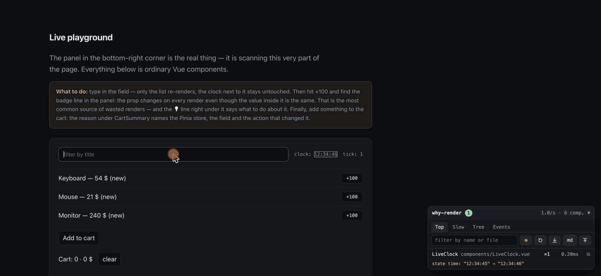

# vue-why-render

Видно, какие компоненты Vue перерисовываются — и **почему именно**.

[](https://www.npmjs.com/package/vue-why-render)
[](https://npmtrends.com/vue-why-render)
[](https://github.com/dadashi44/vue-why-render/blob/main/LICENSE)

**[Живое демо →](https://vue-why-render.js.org/)** · [English](https://github.com/dadashi44/vue-why-render/blob/main/README.md) · [中文](https://github.com/dadashi44/vue-why-render/blob/main/docs/README.zh-CN.md)



Аналоги для Vue умеют мигать рамкой вокруг обновившегося компонента. Этого хватает,
чтобы заметить проблему, но не чтобы её починить: остаётся вопрос «а что вообще
изменилось?». `vue-why-render` отвечает на него — называет конкретную реактивную
зависимость, которая дёрнула рендер.

```
ProductCard ×7 · 2.4ms · badge
└─ проп badge: { text } → { text } — новая ссылка, значение то же
```

В React такое приходится угадывать диффом пропсов. Vue отдаёт причину сам, через
хук `renderTriggered` — пакет построен вокруг него.

## Установка

```sh
npm install -D vue-why-render
pnpm add -D vue-why-render
yarn add -D vue-why-render
bun add -d vue-why-render
```

Нужен Vue 3.3+. Рантайм-зависимостей у пакета нет.

## Подключение

```ts
// Vue: main.ts
import { createApp } from 'vue'
import VueWhyRender from 'vue-why-render'
import App from './App.vue'

createApp(App).use(VueWhyRender).mount('#app')
```

Плагин предназначен для разработки: оберните `app.use(...)` в `if (import.meta.env.DEV)`, см. [Стоимость](https://vue-why-render.js.org/docs/ru/concepts/cost/).

```ts
// Nuxt: nuxt.config.ts
export default defineNuxtConfig({
    modules: ['vue-why-render/nuxt'],
})
```

## Документация

Полная документация: **<https://vue-why-render.js.org/docs/ru/>**

- **Начало**: [Введение](https://vue-why-render.js.org/docs/ru/), [Установка](https://vue-why-render.js.org/docs/ru/start/installation/), [Vue](https://vue-why-render.js.org/docs/ru/start/vue/), [Nuxt](https://vue-why-render.js.org/docs/ru/start/nuxt/)
- **Руководства**: [Панель и оверлей](https://vue-why-render.js.org/docs/ru/guides/panel/), [Pinia](https://vue-why-render.js.org/docs/ru/guides/pinia/), [Vue Router](https://vue-why-render.js.org/docs/ru/guides/router/), [Подсказки](https://vue-why-render.js.org/docs/ru/guides/hints/), [Отчёты](https://vue-why-render.js.org/docs/ru/guides/reports/), [Проверки в тестах](https://vue-why-render.js.org/docs/ru/guides/tests/), [Бюджеты](https://vue-why-render.js.org/docs/ru/guides/budgets/), [ИИ-агенты (MCP)](https://vue-why-render.js.org/docs/ru/guides/mcp/), [Расширение для VS Code](https://vue-why-render.js.org/docs/ru/guides/vscode/)
- **Как это работает**: [Как определяется причина](https://vue-why-render.js.org/docs/ru/concepts/reason/), [Стоимость](https://vue-why-render.js.org/docs/ru/concepts/cost/), [WASM-движок](https://vue-why-render.js.org/docs/ru/concepts/wasm/)
- **Справочник**: [Опции](https://vue-why-render.js.org/docs/ru/reference/options/), [API](https://vue-why-render.js.org/docs/ru/reference/api/), [API для тестов](https://vue-why-render.js.org/docs/ru/reference/test-api/)
- **Ещё**: [Сравнение с другими инструментами](https://vue-why-render.js.org/docs/ru/more/comparison/), [Частые вопросы](https://vue-why-render.js.org/docs/ru/more/faq/), [Чего пакет не делает](https://vue-why-render.js.org/docs/ru/more/limitations/), [Разработка и участие](https://vue-why-render.js.org/docs/ru/more/contributing/)

## Лицензия

MIT
