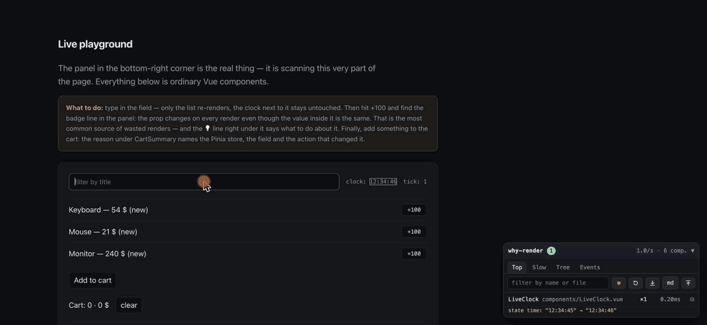

# vue-why-render

看清哪些 Vue 组件在重新渲染 —— 以及**究竟为什么**。

[](https://www.npmjs.com/package/vue-why-render)
[](https://npmtrends.com/vue-why-render)
[](https://github.com/dadashi44/vue-why-render/blob/main/LICENSE)

**[在线演示 →](https://vue-why-render.js.org/)** · [English](https://github.com/dadashi44/vue-why-render/blob/main/README.md) · [Русский](https://github.com/dadashi44/vue-why-render/blob/main/docs/README.ru.md)



同类工具会在刚更新的组件周围闪一圈边框。这足以让你发现问题，却不足以让你修好它 ——
你依然要问：*到底是什么变了？* `vue-why-render` 回答的正是这个问题：它会指出触发这次
渲染的那个具体的响应式依赖。

```
ProductCard ×7 · 2.4ms · badge
└─ prop badge: { text } → { text } — 新引用，值未变
```

在 React 里这只能靠逐个比对 props 去猜。而 Vue 通过 `renderTriggered` 钩子直接把原因
交给你 —— 本包正是围绕它构建的。

## 安装

```sh
npm install -D vue-why-render
pnpm add -D vue-why-render
yarn add -D vue-why-render
bun add -d vue-why-render
```

需要 Vue 3.3+。本包没有任何运行时依赖。

## 使用

```ts
// Vue: main.ts
import { createApp } from 'vue'
import VueWhyRender from 'vue-why-render'
import App from './App.vue'

createApp(App).use(VueWhyRender).mount('#app')
```

该插件仅用于开发环境：请将 `app.use(...)` 包在 `if (import.meta.env.DEV)` 中，详见[开销](https://vue-why-render.js.org/docs/zh-cn/concepts/cost/)。

```ts
// Nuxt: nuxt.config.ts
export default defineNuxtConfig({
    modules: ['vue-why-render/nuxt'],
})
```

## 文档

完整文档：**<https://vue-why-render.js.org/docs/zh-cn/>**

- **开始**: [简介](https://vue-why-render.js.org/docs/zh-cn/), [安装](https://vue-why-render.js.org/docs/zh-cn/start/installation/), [Vue](https://vue-why-render.js.org/docs/zh-cn/start/vue/), [Nuxt](https://vue-why-render.js.org/docs/zh-cn/start/nuxt/)
- **指南**: [面板与高亮层](https://vue-why-render.js.org/docs/zh-cn/guides/panel/), [Pinia](https://vue-why-render.js.org/docs/zh-cn/guides/pinia/), [Vue Router](https://vue-why-render.js.org/docs/zh-cn/guides/router/), [提示](https://vue-why-render.js.org/docs/zh-cn/guides/hints/), [报告](https://vue-why-render.js.org/docs/zh-cn/guides/reports/), [测试中的渲染断言](https://vue-why-render.js.org/docs/zh-cn/guides/tests/), [预算](https://vue-why-render.js.org/docs/zh-cn/guides/budgets/), [AI 代理 (MCP)](https://vue-why-render.js.org/docs/zh-cn/guides/mcp/), [VS Code 扩展](https://vue-why-render.js.org/docs/zh-cn/guides/vscode/)
- **工作原理**: [原因是如何判定的](https://vue-why-render.js.org/docs/zh-cn/concepts/reason/), [开销](https://vue-why-render.js.org/docs/zh-cn/concepts/cost/), [WASM 引擎](https://vue-why-render.js.org/docs/zh-cn/concepts/wasm/)
- **参考**: [配置项](https://vue-why-render.js.org/docs/zh-cn/reference/options/), [API](https://vue-why-render.js.org/docs/zh-cn/reference/api/), [测试 API](https://vue-why-render.js.org/docs/zh-cn/reference/test-api/)
- **更多**: [与其他工具的比较](https://vue-why-render.js.org/docs/zh-cn/more/comparison/), [常见问题](https://vue-why-render.js.org/docs/zh-cn/more/faq/), [本包不做什么](https://vue-why-render.js.org/docs/zh-cn/more/limitations/), [开发与参与贡献](https://vue-why-render.js.org/docs/zh-cn/more/contributing/)

## 许可证

MIT
